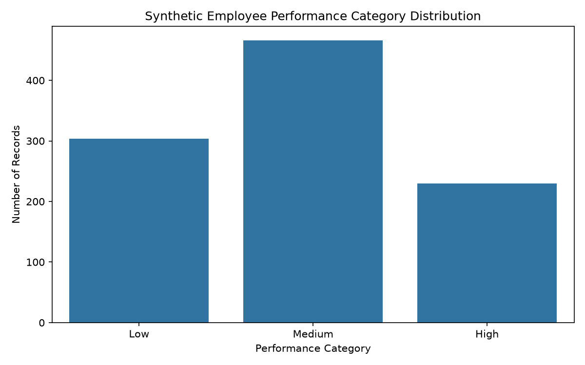
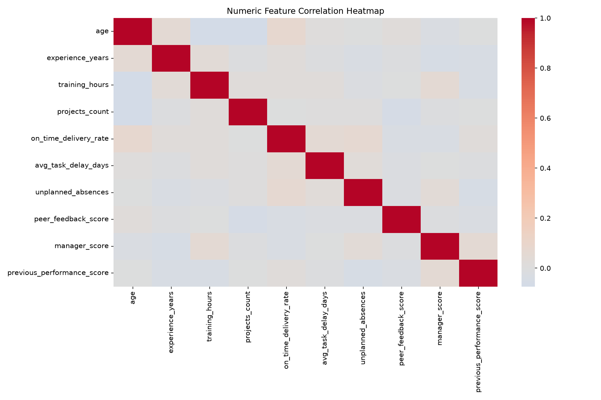
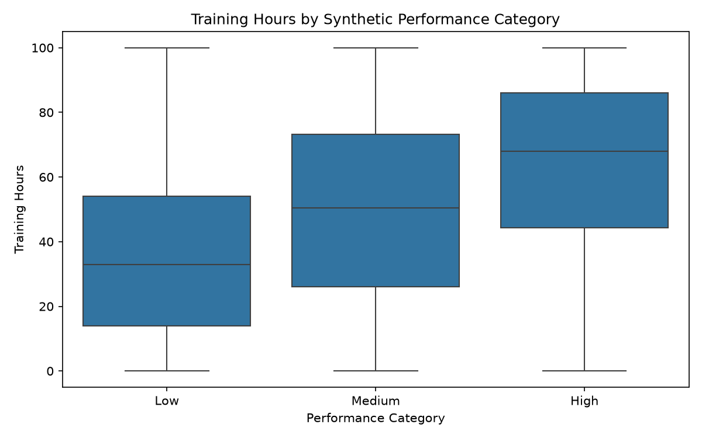
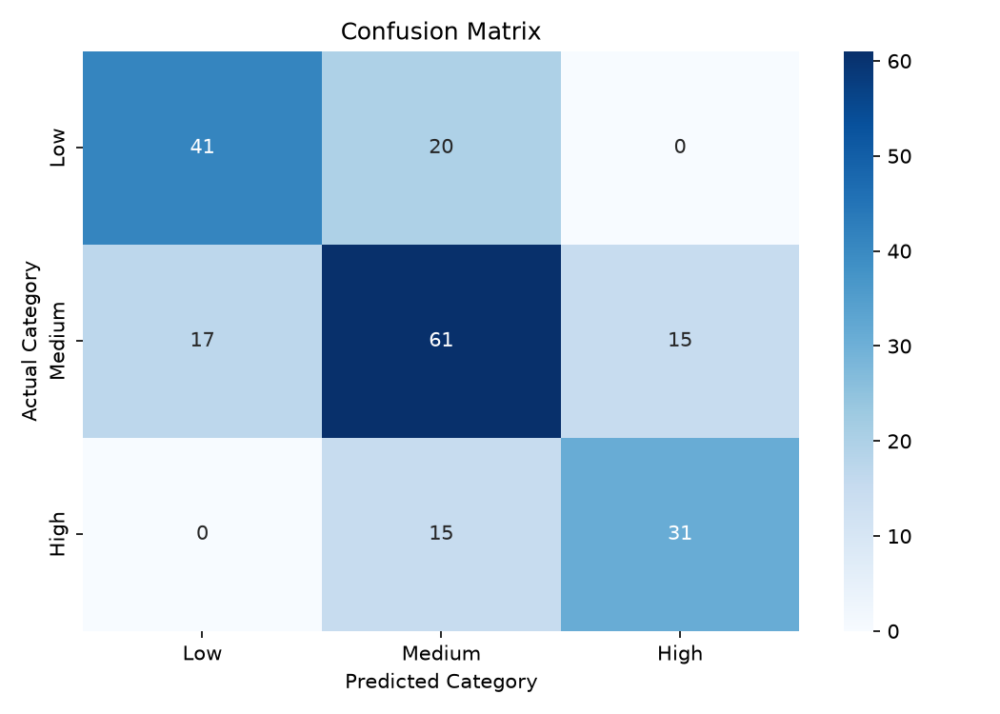
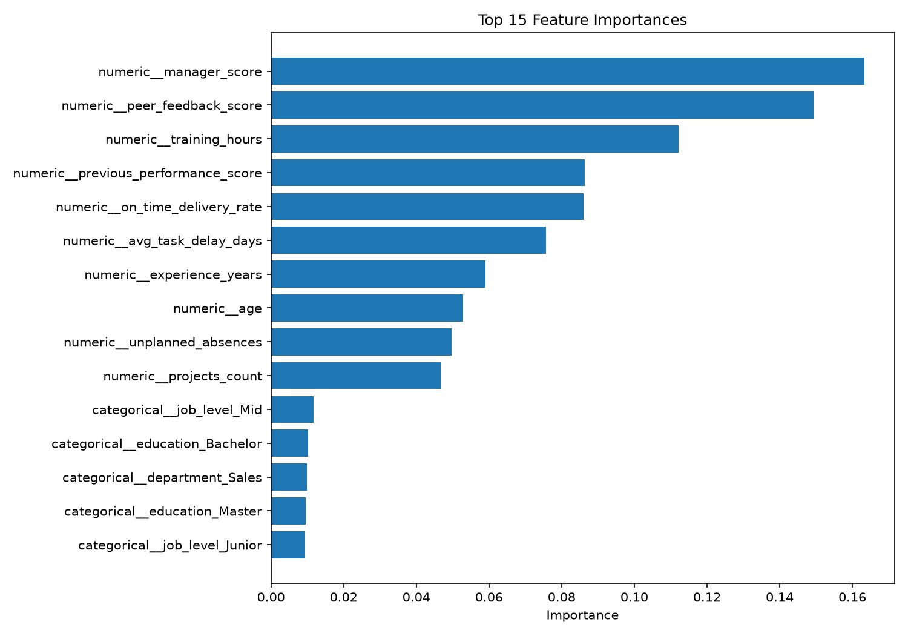

# 👩‍💼 Employee Performance Predictor Using Data Analytics

[](https://www.python.org/)
[](https://scikit-learn.org/)
[](https://streamlit.io/)
[]()

## 🚀 Live Demo

**[Click here to open the Employee Performance Predictor Dashboard](https://employee-performance-predictor-nuwymmawzzvbabxlfitrma.streamlit.app/)**

## 📌 GitHub Repository

**[View Source Code on GitHub](https://github.com/mr6975444-design/Employee-Performance-Predictor)**

---

## 📖 Project Overview

The Employee Performance Predictor is a machine learning and data analytics project designed to analyze employee-related information and predict employee performance categories.

The project uses Python, Pandas, NumPy, Scikit-learn, Matplotlib, Seaborn, and Streamlit to perform data preprocessing, exploratory data analysis, model training, evaluation, and interactive predictions.

The dashboard allows users to enter employee information and receive a predicted performance category: Low, Medium, or High.

**This project uses synthetic employee data for educational and demonstration purposes.**

## 🎯 Project Objectives

- Analyze employee-related data using Python.
- Perform data cleaning and preprocessing.
- Explore patterns and relationships in employee data.
- Build a machine learning classification model.
- Predict employee performance categories.
- Evaluate model performance using classification metrics.
- Create an interactive dashboard using Streamlit.

## 🛠️ Technologies Used

| Technology | Purpose |
|---|---|
| Python 3.11 | Programming language |
| Pandas | Data manipulation |
| NumPy | Numerical operations |
| Matplotlib | Data visualization |
| Seaborn | Statistical visualization |
| Scikit-learn | Machine learning |
| Random Forest | Classification algorithm |
| Joblib | Model saving and loading |
| Streamlit | Interactive dashboard |
| Git and GitHub | Version control |

## 📂 Project Structure

```text
Employee-Performance-Predictor/
│
├── app.py
├── requirements.txt
├── README.md
├── .gitignore
│
├── data/
│   └── employee_data.csv
│
├── src/
│   ├── __init__.py
│   ├── generate_data.py
│   ├── analyze_data.py
│   └── train_model.py
│
├── models/
│   └── employee_performance_model.joblib
│
├── outputs/
│   ├── cleaned_employee_data.csv
│   ├── data_summary.csv
│   ├── metrics.csv
│   ├── classification_report.csv
│   ├── test_predictions.csv
│   └── feature_importance.csv
│
└── images/
    ├── performance_distribution.png
    ├── correlation_heatmap.png
    ├── training_hours_by_category.png
    ├── confusion_matrix.png
    ├── feature_importance.png
    ├── dashboard_prediction.png
    ├── dashboard_evaluation.png
    └── dashboard_information.png
```

## 📊 Dataset Information

The project uses a synthetic employee dataset containing:

- **Total records:** 1,000
- **Total columns:** 15
- **Target variable:** `performance_band`
- **Performance categories:** Low, Medium, High

The dataset includes employee-related features such as:

- Training hours
- Attendance percentage
- Task completion rate
- Average task delay
- Peer feedback score
- Previous performance score

The dataset is generated programmatically and does not contain real employee records.

## 📈 Exploratory Data Analysis

Exploratory Data Analysis (EDA) was performed to understand the dataset, identify patterns, and visualize relationships between variables.

### 1. Performance Distribution



### 2. Correlation Heatmap



### 3. Training Hours by Performance Category



## 🤖 Machine Learning Model

A **Random Forest Classifier** was used to predict employee performance categories.

### Data Preprocessing

- Missing-value handling using SimpleImputer.
- Numerical feature preprocessing.
- Categorical feature encoding using OneHotEncoder.
- Numerical feature scaling using StandardScaler.
- Training and testing split of 80:20.

### Model Configuration

- Algorithm: Random Forest Classifier
- Number of estimators: 200
- Class balancing: Enabled
- Random state: 42
- Evaluation: Accuracy, precision, recall, and F1-score.

## 📉 Model Performance

The trained model achieved the following results on the test dataset:

| Evaluation Metric | Result |
|---|---:|
| Accuracy | 66.5% |
| Macro F1-score | 0.669 |

### Classification Report

| Performance Category | Precision | Recall | F1-score |
|---|---:|---:|---:|
| Low | 0.71 | 0.67 | 0.69 |
| Medium | 0.64 | 0.66 | 0.65 |
| High | 0.67 | 0.67 | 0.67 |

### Confusion Matrix



### Feature Importance



## 🖥️ Streamlit Dashboard

The project includes an interactive Streamlit dashboard with employee performance prediction and model evaluation information.

### Dashboard Screenshots

**1. Prediction Dashboard**


**2. Model Evaluation Dashboard**


**3. Project Information Dashboard**


**Try the live application:**  
[Employee Performance Predictor – Streamlit App](https://employee-performance-predictor-nuwymmawzzvbabxlfitrma.streamlit.app/)

## ⚙️ Installation and Setup

Follow these steps to run the project locally.

### Step 1: Clone the Repository

```bash
git clone https://github.com/mr6975444-design/Employee-Performance-Predictor.git
```

### Step 2: Navigate to the Project Folder

```bash
cd Employee-Performance-Predictor
```

### Step 3: Create a Virtual Environment

```bash
python3 -m venv .venv
```

### Step 4: Activate the Virtual Environment

For macOS and Linux:

```bash
source .venv/bin/activate
```

### Step 5: Install Dependencies

```bash
pip install -r requirements.txt
```

### Step 6: Run the Streamlit Application

```bash
python -m streamlit run app.py
```

Open the local dashboard at:

http://localhost:8501

## 📁 Project Scripts

| File | Description |
|---|---|
| `generate_data.py` | Generates synthetic employee data |
| `analyze_data.py` | Performs data cleaning and exploratory analysis |
| `train_model.py` | Trains and evaluates the machine learning model |
| `app.py` | Runs the interactive Streamlit dashboard |

## 📌 Key Learnings

Through this project, I learned:

- Data cleaning and preprocessing.
- Exploratory Data Analysis.
- Data visualization.
- Machine learning classification.
- Random Forest model training.
- Model evaluation.
- Building interactive dashboards.
- Using Git and GitHub for project management.
- Deploying Python applications using Streamlit Community Cloud.

## ⚠️ Limitations and Ethical Considerations

- The dataset is synthetic and does not represent actual employee performance.
- The model is developed for educational purposes only.
- Previous performance information contributes to the synthetic target-generation process, so model results may reflect that built-in relationship.
- The model should not be used to make hiring, promotion, salary, disciplinary, or other employment decisions.
- Real-world employee evaluation requires validated data, fairness assessments, human oversight, and appropriate privacy protections.

## 🔮 Future Improvements

- Use suitable real-world, ethically sourced datasets.
- Explore additional machine learning algorithms.
- Improve model performance and generalization.
- Add more interactive visualizations.
- Improve model explainability.
- Add fairness and bias evaluation.

## 👩‍💻 Author

**Meghana**

GitHub: [@mr6975444-design](https://github.com/mr6975444-design)

Project Repository: [Employee Performance Predictor](https://github.com/mr6975444-design/Employee-Performance-Predictor)

Live Dashboard: [Open Streamlit App](https://employee-performance-predictor-nuwymmawzzvbabxlfitrma.streamlit.app/)

---

⭐ If you find this project interesting, feel free to explore the repository and the live dashboard!


**Thank you for visiting my project!**