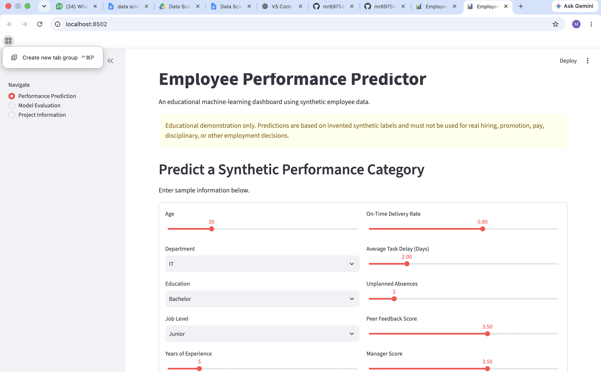
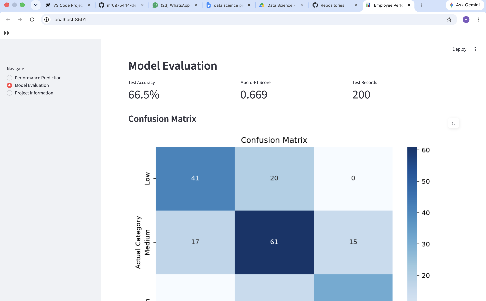
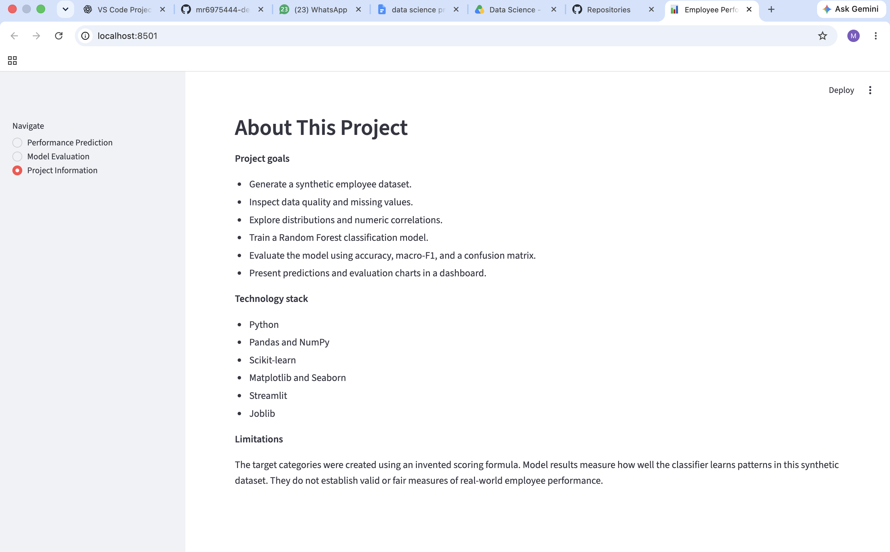

# Employee Performance Predictor Using Data Analytics

## Project Overview

The Employee Performance Predictor is a Python-based machine learning project that analyzes employee-related data and predicts a performance category: **Low, Medium, or High**.

The project uses a synthetic dataset to demonstrate data preprocessing, exploratory data analysis, machine learning model training, and interactive visualization.

## Objectives

- Generate and analyze employee data.
- Clean and preprocess missing values.
- Explore performance patterns using charts.
- Train a machine learning classification model.
- Evaluate model performance using accuracy, precision, recall, F1-score, and a confusion matrix.
- Build an interactive dashboard using Streamlit.

## Technologies Used

- Python 3.11
- Pandas and NumPy
- Scikit-learn
- Matplotlib and Seaborn
- Joblib
- Streamlit

## Project Structure

```text
Employee-Performance-Predictor/
├── app.py
├── requirements.txt
├── data/
│   └── employee_data.csv
├── src/
│   ├── __init__.py
│   ├── generate_data.py
│   ├── analyze_data.py
│   └── train_model.py
├── models/
│   └── employee_performance_model.joblib
├── outputs/
│   ├── cleaned_employee_data.csv
│   ├── data_summary.csv
│   ├── metrics.csv
│   ├── classification_report.csv
│   ├── test_predictions.csv
│   └── feature_importance.csv
└── images/
    ├── performance_distribution.png
    ├── correlation_heatmap.png
    ├── training_hours_by_category.png
    ├── confusion_matrix.png
    └── feature_importance.png
```

## Machine Learning Model

The project uses a Random Forest Classifier with preprocessing pipelines for numerical and categorical features.

The model is trained on 80% of the dataset and evaluated on the remaining 20%.

### Current Results

- **Accuracy:** 66.5%
- **Macro F1-score:** 0.669
- **Test records:** 200

These results are from the current synthetic dataset and should not be interpreted as evidence of real-world employee performance prediction accuracy.

## How to Run the Project

### 1. Clone the repository

```bash
git clone YOUR_GITHUB_REPOSITORY_URL
cd Employee-Performance-Predictor
```

Replace `YOUR_GITHUB_REPOSITORY_URL` with your actual repository URL.

### 2. Create and activate a virtual environment

On macOS or Linux:

```bash
python3 -m venv .venv
source .venv/bin/activate
```

### 3. Install dependencies

```bash
pip install -r requirements.txt
```

### 4. Launch the dashboard

```bash
python -m streamlit run app.py
```

Streamlit will provide a local URL that you can open in your browser.

## Features

- Synthetic employee dataset generation
- Data quality checks and exploratory analysis
- Machine learning model training
- Performance category prediction
- Model evaluation dashboard
- Feature importance visualization

## Limitations and Ethical Considerations

This project is intended for educational and demonstration purposes only. It uses synthetic data and a simulated performance-labeling process. Its predictions may reflect patterns built into the data-generation formula rather than meaningful real-world relationships.

The model has not been validated for actual workplace use. It should not be used to make hiring, promotion, compensation, disciplinary, or other employment decisions.

## Future Improvements

- Evaluate the model on appropriate, representative real-world data with proper authorization.
- Improve model validation and investigate potential data leakage.
- Compare multiple classification algorithms.
- Add fairness and bias assessments.
- Improve the dashboard with additional visualizations.

## Author

Add your name here.

## License

This project is available for educational use. Add a license if you intend to distribute or reuse it publicly.

## Dashboard Screenshots

### Performance Prediction



### Model Evaluation



### Project Information

